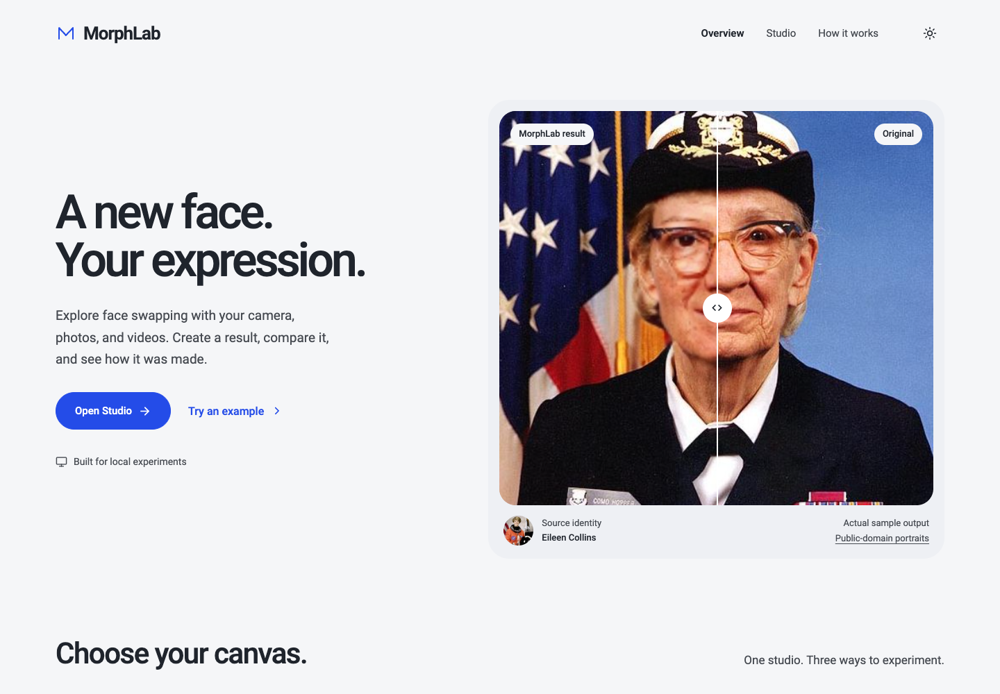
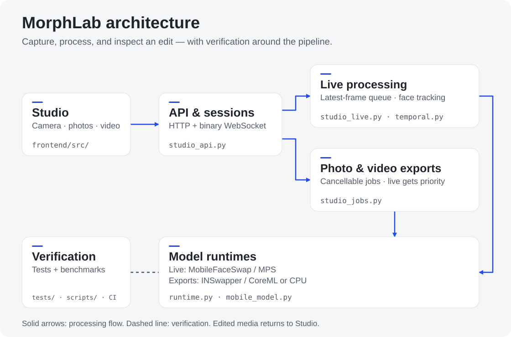

# MorphLab

**A local-first face editing studio with hardware-aware inference and reproducible evaluation.**

Live webcam swapping, photo editing, and short-video exports in one React/TypeScript application, backed by FastAPI. MorphLab extends [Deepfake_Project](https://github.com/shauryasuyal/Deepfake_Project) with a bounded streaming pipeline, automatic person tracking, native Apple Silicon execution, and an evidence-driven testing workflow.

[Quick start](#quick-start) · [Architecture](#architecture) · [Measured results](#measured-results) · [Queryable codebase](#queryable-codebase) · [Testing](#testing-and-release-assurance)



The landing page's before/after is an actual generated edit using attributed public-domain portraits. [Sample provenance](assets/examples/ATTRIBUTION.md). These images do not imply endorsement by the people pictured.

## What it does

- **Live:** detect faces before choosing a source, capture a source from the webcam or upload a portrait, and swap automatically. The tracker follows the main person; Person thumbnails and Auto offer optional control. After a two-second departure window, it can choose another visible person.
- **Photo and video:** start with three example pairs or upload media, inspect results, and download labelled edits and JSON reports. Video jobs expose progress and cancellation, preserve audio, and yield to live inference between frames.
- **Hardware-aware execution:** validated MobileFaceSwap/PyTorch MPS for live processing on the tested M4; native CoreML variants for the standard export model; CPU fallback with explicit runtime reporting. CUDA requires a compatible installation and successful warmup; it has not been hardware-validated here.
- **Engineering controls:** opt-in stage profiler, source suitability advice, continuous boundary masks, frame revision checks, bounded queues, and explicit session-data clearing.
- **Simple interface:** Overview, Studio, and How It Works; Material-inspired platinum, graphite, and cobalt themes, responsive layouts, keyboard controls, and reduced-motion support.

MorphLab integrates pretrained models; it does not introduce a newly trained generator or determine whether arbitrary media is authentic. Only edit media you have permission to use. Local browser frames are sent to the local Python service; this is not browser-only inference.

## Quick start

Requirements: **Python 3.11**, **Node.js 22+**, npm, **FFmpeg/FFprobe**, and enough disk space for model downloads and optional conversion caches. InsightFace may require a C++ build toolchain. macOS acceleration runs natively, outside Docker.

```bash
git clone https://github.com/Ritwik389/MorphLab.git
cd MorphLab
bash scripts/setup.sh
./scripts/start_local.sh
```

Open [localhost:7860](http://127.0.0.1:7860). Subsequent launches need only `./scripts/start_local.sh`; stop with Ctrl+C. Camera permission is requested when you press **Start camera**. Photo mode preselects an example without processing it automatically.

Setup installs locked dependencies, verifies downloaded models by SHA-256, and builds the frontend. On Apple Silicon it also prepares optional MPS/CoreML acceleration. The base weights total approximately 716 MiB; the optional MobileFaceSwap archive is approximately 543 MB. Model and dataset terms apply separately from application source.

For a CPU-only setup, run `AIMS_SKIP_ACCELERATION=1 bash scripts/setup.sh`. To prepare acceleration later, run `bash scripts/setup_mac_acceleration.sh`. Existing `AIMS_*` environment variables remain supported for installation compatibility; the product's previous name was AIMS.

**Windows / CPU:** install Python 3.11 with the `py` launcher, Node.js, FFmpeg, and Microsoft C++ Build Tools if required, then:

```powershell
git clone https://github.com/Ritwik389/MorphLab.git
cd MorphLab
powershell -File scripts/setup_windows.ps1
powershell -File scripts/start_windows.ps1
```

The Windows setup path and CI definitions are included; a completed Windows hardware run is not claimed. For readiness diagnostics: `.venv/bin/python scripts/doctor.py --verify-models` (use `.venv\Scripts\python.exe` on Windows).

## Architecture

The map below follows an edit from the browser to the model runtime. Live processing and offline exports share inference capacity; verification checks their behaviour.

<picture>
  <source media="(max-width: 600px)" srcset="docs/images/morphlab-code-map-mobile.svg">
  
</picture>

[Open full-size map](docs/images/morphlab-code-map.svg) · [Explore the complete code graph](#queryable-codebase)

*Six curated responsibility groups, backed by Graphify source nodes and reviewed processing paths. Dashed connections represent verification.*

One frame executes while at most one newer frame waits; new arrivals replace stale pending work. Source and selection revisions prevent old results from being displayed after changes. Canvas rendering avoids a React state update per video frame. Session-local tracking combines appearance association, optical flow, periodic detection, and current-frame 106-point geometry.

Live receives inference priority; offline jobs resume when capacity is available. The maintained deployment uses **one application worker** because sessions and scheduling live in process memory. Backend hardware determines acceleration: a hosted server cannot borrow a visitor's Mac GPU.

| Area | Main implementation |
|---|---|
| Website and camera lifecycle | [`frontend/src`](frontend/src) |
| HTTP/WebSocket API and media limits | [`studio_api.py`](modules/studio_api.py) |
| Live sessions and bounded scheduling | [`studio_live.py`](modules/studio_live.py) |
| Tracking and geometry | [`temporal.py`](modules/temporal.py) |
| Runtime selection and model caches | [`runtime.py`](modules/runtime.py), [`mobile_model.py`](modules/mobile_model.py) |
| Export progress and cancellation | [`studio_jobs.py`](modules/studio_jobs.py) |
| Evaluation and evidence integrity | [`evaluation.py`](modules/evaluation.py), [`scripts`](scripts) |

## Measured results

These are **historical pre-rename candidate measurements**, not a fresh certification of every later revision. The evaluated product tree SHA-256 is `8e838672a8698eb39f24b425b11e03f06ba82ed2b0a455a345e3e646f9d51d64`. The upstream Git base alone does not identify that modified tree. A portable record with report hashes and conditions is in [benchmark results](docs/BENCHMARKS.json); the [engineering case study](docs/FLAGSHIP_CASE_STUDY.md) explains rejected approaches.

| Experiment | Recorded result | Conditions / interpretation |
|---|---|---|
| Five two-minute live browser trials | **19.6–21.3 newly displayed swaps/s**; per-trial p95 **76.5–115 ms** | Apple M4, 16 GiB, Chrome 156, 640×480, MPS, warmed model, worker on, HUD off, battery power; genuine speech/expression **fake-camera replay** |
| Throughput gate | Every ten-second interval ≥15 FPS; minimum **16 FPS** | These five replay trials; not a physical-webcam or broad head-turn result |
| CoreML INT8 live screen | **12.16 FPS**, p95 **143.3 ms** | One two-minute trial; missed throughput gate, retained for offline use |
| Longevity | **72,859** new swaps in one hour; **100 Start/Stop cycles** passed | Browser replay and cleanup checks; no settled backend RSS growth in this run |
| Boundary-mask quality comparison | Paired median AdaFace cosine delta **−0.00051** versus binary mask | 12 validation clips / four identities; same mobile generator; diagnostic tolerance 0.02, not recognition accuracy |
| Prior automated verification | **107 backend**, **7 frontend unit**, **8 browser workflow** tests passed | Separate deterministic, real-model, and browser checks; unavailable human checks remain pending |

MobileFaceSwap was chosen for live throughput; the standard generator offers stronger identity resemblance on tested examples and remains available for exports. Mask variants, detection cadence, geometry, smoothing, and worker/HUD overhead were compared separately rather than combined into an arbitrary score. [Experiment protocol and results](docs/EXPERIMENTS.md).

**Release status: research candidate.** Physical-webcam and native-Safari review, blinded human quality review, and reviewed/frozen held-out tracking evaluation remain **Not Run**. The historical Debian container failed its OS-library gate. The replacement Wolfi runtime passes the local HIGH/CRITICAL scan; hosted CI enforces the same gate. Human and held-out acceptance remain incomplete. A passed replay test does not satisfy these missing gates. [Release checklist](docs/RELEASE.md) · [Security scope](docs/SECURITY.md).

## Queryable codebase

The overview above highlights six responsibilities. The complete **Graphify knowledge graph** lets you inspect individual modules, dependencies, and their source locations. It covers authored code and technical documentation; model/data caches, generated images, translations, and vendored implementations are excluded.

- **Browse visually:** [download the interactive graph](graphify-out/graph.html) and open it locally. GitHub displays HTML source rather than running it.
- **Inspect the evidence:** [graph audit](graphify-out/GRAPH_REPORT.md), [build scope](graphify-out/BUILD_AUDIT.json), and [overview-to-source mapping](graphify-out/OVERVIEW.json).
- **Query locally:** use the committed [graph JSON](graphify-out/graph.json), without loading models or supplying an API key.

```bash
uv tool install graphifyy==0.9.95

# How does a live session handle tracking and source changes?
graphify query "tracking source revision" --seed modules_studio_live_livesession --budget 1500

# Where are inference backends selected and prepared?
graphify query "backend model warmup" --seed modules_runtime_modelregistry --budget 1500
```

The full graph preserves structural and semantic provenance; inferred relationships are labelled. Its queries return source context, so verify the linked implementation before drawing conclusions. Refresh structural code with `graphify update .` and documentation semantics with the Graphify skill. [Refresh and rendering instructions](docs/CODE_GRAPH.md).

## Testing and release assurance

After setup, use the virtual environment's Python (or activate it). Start the app before browser workflows:

```bash
.venv/bin/python scripts/verify.py --suite smoke
.venv/bin/python scripts/verify.py --suite regression
.venv/bin/python scripts/verify.py --suite evaluation
.venv/bin/python scripts/verify.py --suite release --evidence experiments/local-evidence.json
```

Each suite writes JSON/CSV/HTML evidence with source/model hashes, hardware/runtime information, and **Passed / Failed / Not Run / Unsupported** states. Release verification deliberately fails when required evidence is absent, failed, or stale. Private recordings, identity embeddings, raw traces, downloaded weights, and local output folders are excluded from Git.

For focused development:

```bash
.venv/bin/python -m pytest -q
cd frontend
npm run test:unit
npm run build
npm test
```

Browser camera tests need Chrome and a fixture: run `.venv/bin/python scripts/build_camera_fixture.py` from the repository root. The corpus fetch and independent AdaFace evaluation are optional research steps; see the strategy before downloading footage or interpreting similarity. CI defines Linux, Windows, and macOS checks, real CPU smoke tests, browser workflows, and container scanning; a workflow definition is not itself a successful run.

| Engineering record | What it contains |
|---|---|
| [Test strategy](docs/TEST_STRATEGY.md) | Risk/requirement traceability, test layers, performance and resource gates |
| [Experiment register](docs/EXPERIMENTS.md) | Controlled alternatives, repetitions, split discipline, failures and decisions |
| [Architecture decisions](docs/DECISIONS.md) | Trade-offs, rejected approaches, reconsideration triggers |
| [Model and data card](docs/MODEL_DATA_CARD.md) | Provenance, licences, intended use and limitations |
| [Security](docs/SECURITY.md) | Tested OWASP ASVS subset, upload/session controls and unresolved findings |
| [Runbook](docs/RELEASE.md) | Clean installation, manual checks, evidence review and rollback |

## Deployment and compatibility

```bash
docker compose up --build
```

The CPU container serves port **7860**, runs as a non-root user, and binds to host loopback in Compose. Model downloads are verified; weights can instead be mounted read-only. Native MPS/CoreML acceleration is unavailable inside this Linux container. Free CPU hosting can support a photo demo but is not equivalent to the measured local M4 pipeline. Review current security evidence and the remaining release gates before public hosting. [Deployment guide](docs/DEPLOYMENT.md).

The desktop app, research CLI and optional legacy Gradio workbench are retained; Gradio is outside the maintained production dependency lock. Launch it with `./scripts/start_local.sh --legacy` only after installing its optional dependencies. Stop/navigation/disconnect clear active camera sessions; export folders expire while the service runs. Disk deletion is not secure erasure.
